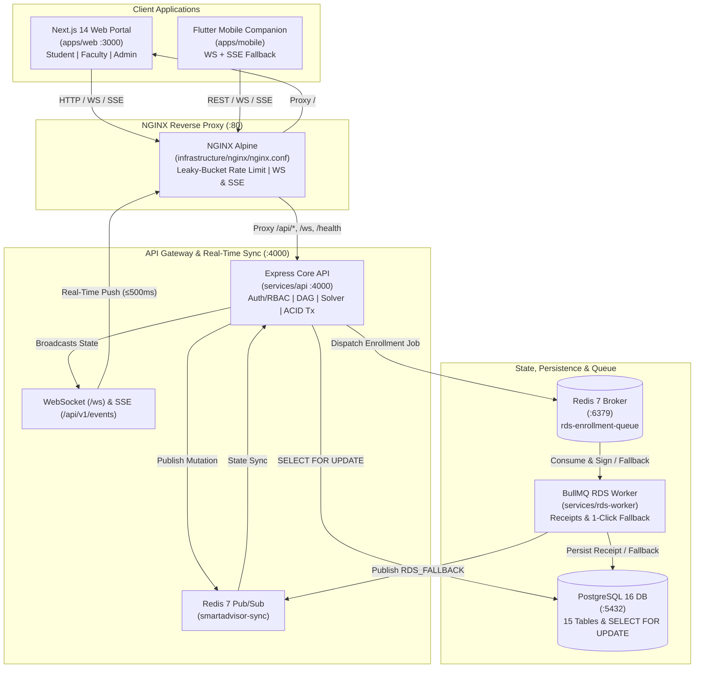

# SmartAdvisor NSU

[](https://github.com/DarkMonarch1/NSU_CSE327_SEC04_ITN/actions/workflows/ci-cd.yml)


> **North South University (NSU)**  
> **Department of Electrical & Computer Engineering (ECE)**  
> **Course:** CSE 327 (Section 04) — Software Engineering  
> **Supervisor:** Intisar Tahmeed Sir `[ITN]`

---

## 1. Executive Summary & Core Engineering Pillars

**SmartAdvisor NSU** is a production-hardened, high-concurrency course advising and registration platform engineered for North South University. It eliminates launch-minute seat contention, prerequisite errors, timetable clashes, and manual faculty advising bottlenecks across Web, Mobile, and background RDS workers.

### Core Engineering Pillars

1. **JWT Authentication, RBAC & Edge Security**
   - Scrypt password verification, short-lived HS256 JWTs (`/api/v1/auth/login`, `/logout`, `/me`) with PostgreSQL/in-memory `jti` token revocation blocklist.
   - Strict role-based access control (`student`, `faculty`, `admin`) plus per-section instructor ownership enforcement (`403`) on capacity expansion.
   - Zod strict payload validation, SQLi/XSS/null-byte inspection (`400 SECURITY_INPUT_REJECTED`), Helmet security headers, configurable CSRF origin enforcement (`403 CSRF_ORIGIN_REJECTED`), and dual-layer Express + NGINX leaky-bucket rate limiting (`429`).

2. **Autonomous `CurriculumGraph` Singleton DAG & Senate Rule Engine**
   - Directed Acyclic Graph (`CurriculumGraph`) validating 10-course NSU prerequisite chains with cycle detection, eligible/blocked course resolution, and critical path calculation (`GET /api/v1/student/dag/eligible`).
   - Enforces North South University Academic Council policies:
     - `RULE-4.2`: Senior Standing Credit Floor ($\ge 100$ earned credits for 400-level courses such as `CSE 425`).
     - `RULE-2.1`: Prerequisite Enforcement & Co-Registration Exemption.
     - `RULE-6.3`: Consecutive Final Exam Load Check.
     - `RULE-8.4`: Department Chair Seat Expansion capped by physical room fire-code ceilings (`LIB 602`: 55, `SAC 502`: 55, `SAC 415`: 55, `NAC 408`: 50, `NAC 510`: 50, `LIB 608`: 45).

3. **Constraint-Based Schedule Solver (`AdvisingEngine` Strategy Pattern)**
   - Supports `MilestoneFirst` and `MinimizeGaps` optimization strategies (`POST /api/v1/student/schedule/solve`) with 0-clash verification, credit-cap enforcement, and 6-day NSU timetable slot modeling (`ST`, `MW`, `RA` = Thu/Sat, `Thu`).

4. **Zero Double-Booking via PostgreSQL 16 ACID Transactions**
   - 15-table PostgreSQL 16 relational schema (`services/api/src/db/schema.sql`) with deterministic sorted `SELECT ... FOR UPDATE` row-level pessimistic locking and `CHECK (enrolled <= capacity)` constraints.
   - Automatic dual-mode in-memory ACID fallback (`withSectionLock` / `withSectionLocks`) when `DATABASE_URL` is unset or in `vitest` CI runs.

5. **Sub-500ms Real-Time Cross-Platform Sync & Headless RDS Worker**
   - All state mutations publish over Redis 7 Pub/Sub (`smartadvisor-sync`) and broadcast via both WebSocket (`ws://host/ws`) and Server-Sent Events (`GET /api/v1/events`) plus browser `BroadcastChannel`.
   - BullMQ worker (`services/rds-worker` on `rds-enrollment-queue`) executes headless RDS handshakes/pushes, issues deterministic `#RDS-TXN-<8HEX>` / `SHA256:<64HEX>` receipts, and emits `RDS_FALLBACK` events in $\le 500\text{ ms}$ for 1-click DAG-compliant section recovery (`POST /api/v1/student/rds/fallback`).

---

## 2. System Architecture & Ports



| Service | Port | Health / Endpoint | Description |
| :--- | :--- | :--- | :--- |
| `nginx` | `80` | `http://localhost/health` | Reverse proxy (`/`, `/api/`, `/api/v1/auth/`, `/api/v1/events`, `/ws`, `/health`) |
| `web` | `3000` | `http://localhost:3000/` | Next.js 14 App Router (Student, Faculty, IT Admin portals) |
| `api` | `4000` | `http://localhost:4000/health` | Express REST, WebSocket (`/ws`), SSE (`/api/v1/events`) |
| `postgres` | `5432` | `pg_isready` | PostgreSQL 16 relational store |
| `redis` | `6379` | `redis-cli ping` | Redis 7 Pub/Sub & BullMQ queue broker |
| `rds-worker` | — | BullMQ consumer | Background worker on `rds-enrollment-queue` |

---

## 3. Seeded Demo Accounts (Quick Reference)

All 12 seeded accounts use password **`SmartAdvisor2025!`** (see [`docs/DEMO_GUIDE.md`](docs/DEMO_GUIDE.md) for the complete 12-account roster, 9 sections, 10-course DAG, and 5-minute live demo script):

| Portal | ID / Username | Name | Role | Notes |
| :--- | :--- | :--- | :--- | :--- |
| Student | `2412159042` | Rahim Ahmed | `student` | Primary demo student (`96/130` Cr, CGPA `3.64`, Cart `#NSU-241215-9042`) |
| Student | `2321450042` | Fariha Tasnim | `student` | Junior (`68` Cr, CGPA `3.42`) |
| Student | `2211290042` | Tanveer Hasan | `student` | Senior (`112` Cr, CGPA `3.81`) |
| Faculty | `nova.ahmed` | Dr. Nova Ahmed | `faculty` | Primary faculty / Chair (owns `CSE425-01`) |
| Faculty | `nabeel.mohammed` | Dr. Nabeel Mohammed | `faculty` | Instructor (owns `CSE327-01`) |
| IT Admin | `admin.itops` | IT Operations Admin | `admin` | System telemetry, RDS4 sync & SEV-1 escalations |

---

## 4. Feature Breakdown by Platform & Role

### Student Web Portal (`/student/dashboard`, `/student/schedule`)
- **Live Seat Radar & DAG Badges**: Search/filter sections, view `DAG Eligible` / `Critical Path` / `Blocked` status, stage/unstage sections (`POST /api/v1/student/cart/stage`, `DELETE /api/v1/student/cart/:sectionId`).
- **Rule 4.2 Petitions & Waitlist**: Full sections trigger the Sold-Out Modal with instant alternative swaps and Waitlist joining (`POST /api/v1/student/waitlist`). Credit/prereq alerts open the Petition Modal (`POST /api/v1/student/petitions`) routed as `pending` to Faculty (no client-side auto-approve).
- **Schedule Solver & 6-Day Timetable**: `MilestoneFirst` / `MinimizeGaps` solver (`POST /api/v1/student/schedule/solve`), 6-day grid (`Saturday`–`Thursday` with `RA` mapped to Thu & Sat and Lunch/Zuhr recess), clash detection, `Simulate RDS Failure` toggle, and 1-Click RDS Fallback (`POST /api/v1/student/rds/fallback`) issuing printable `#RDS-TXN-*` / `SHA256:*` receipts.

### Faculty Web Portal (`/faculty/exceptions`, `/faculty/courses`, `/faculty/rules`)
- **Exception Queue**: 6-point rule audit inspector with atomic `Approve`, `Reject`, and `Flag` decisions (`POST /api/v1/faculty/exceptions/decision`) and duplicate-decision protection (`409`).
- **Capacity Governance**: `Your Section` vs `Other Faculty` ownership enforcement (`403` for non-owners) and room fire-code ceiling checks (`422`) via `POST /api/v1/faculty/sections/expand-capacity`.
- **Senate Bypass Rules**: Toggle built-in rules (`POST /api/v1/faculty/rules/toggle`) or create custom rules (`POST /api/v1/faculty/rules`) with automatic approval of matching pending petitions.

### IT Admin Operations Portal (`/admin/health`, `/admin/escalations`)
- **Live Component Health & SLA Telemetry**: Probes `api`, `postgres`, and `redis` via `/health` (`503` when degraded), renders SVG throughput/latency graphs, detects 60s sustained SLA breaches, scales nodes (`POST /api/v1/admin/scale`), and acknowledges incidents (`POST /api/v1/admin/acknowledge`).
- **SEV-1 Escalations & RDS4 Sync**: Syncs snapshots (`POST /api/v1/admin/rds4/sync`), adds seats across courses (`POST /api/v1/admin/courses/add-seats`), provisions emergency `Sec 05` (`POST /api/v1/admin/sections/emergency`), and auto-escalates zero-seat bottlenecks.

### Flutter Mobile Student Companion (`apps/mobile`)
- Connects via REST + WebSocket (`ws://.../ws`) with automatic SSE (`/api/v1/events`) fallback and graceful offline test/demo fallback.
- 8 screens across 4 bottom tabs (`Advising`, `Schedule`, `Prereqs`, `Alerts & IT`) covering Credit Ring, Priority Window, DAG chain, AI Optimize Cart, 1-click RDS fallback, and seat alerts.

---

## 5. Backend API & Worker Reference

| Method | Endpoint | Auth / Role | Description |
| :--- | :--- | :--- | :--- |
| `GET` | `/health` | Public | Probes API, PostgreSQL (`SELECT 1`), and Redis (`PING`); returns `200` (`ok`) or `503` (`degraded`). |
| `POST` | `/api/v1/auth/login` | Public | Authenticates ID + password (+ optional role); returns HS256 JWT & user claims. |
| `POST` | `/api/v1/auth/logout` | Bearer JWT | Revokes current token `jti` in `revoked_tokens` / blocklist. |
| `GET` | `/api/v1/auth/me` | Bearer JWT | Returns authenticated user claims (`401` if revoked/expired/tampered). |
| `GET` | `/api/v1/bootstrap` | Optional JWT | Hydrates student, sections, staged cart, clashes, exceptions, rules, metrics, escalations, DAG summary & fallback prompt. |
| `GET` | `/api/v1/events` | Public | Server-Sent Events (SSE) stream backed by Redis Pub/Sub `smartadvisor-sync`. |
| `WS` | `/ws` | Optional `?token=` | WebSocket hub with 30s ping/pong heartbeats for sub-500ms live sync. |
| `POST` | `/api/v1/student/cart/stage` | `student` | Stages section with ACID lock, DAG prereqs, `RULE-4.2`/`2.1`/`6.3` (`422`), and full-section modal (`409`). |
| `DELETE` | `/api/v1/student/cart/:sectionId` | `student` | Removes staged section from cart. |
| `POST` | `/api/v1/student/petitions` | `student` | Submits pending rule exception petition (`201`). |
| `POST` | `/api/v1/student/waitlist` | `student` | Enrolls student in waitlist for full section (`200`). |
| `POST` | `/api/v1/student/schedule/solve` | `student` | Runs `AdvisingEngine` (`MilestoneFirst` or `MinimizeGaps`). |
| `GET` | `/api/v1/student/dag/eligible` | `student` | Returns DAG eligible courses, blocked prerequisites, critical path, and cycle status. |
| `POST` | `/api/v1/student/enroll/confirm` | `student` | Locks schedule (`SELECT ... FOR UPDATE`), enqueues BullMQ job, returns `#RDS-TXN-*` / `SHA256:*` receipt (or `fallbackPrompt`). |
| `POST` | `/api/v1/student/rds/fallback` | `student` | Atomically swaps failed section for DAG-compliant alternative and re-confirms enrollment. |
| `POST` | `/api/v1/faculty/exceptions/decision` | `faculty` \| `admin` | Approves/rejects/flags pending petition (`409` if already finalized). |
| `POST` | `/api/v1/faculty/sections/expand-capacity` | Owner `faculty` \| `admin` | Expands capacity up to room fire-code cap (`403` non-owner, `422` over room cap). |
| `POST` | `/api/v1/faculty/rules` | `faculty` \| `admin` | Creates new Senate bypass rule (`201`). |
| `POST` | `/api/v1/faculty/rules/toggle` | `faculty` \| `admin` | Toggles rule and auto-approves matching pending petitions. |
| `POST` | `/api/v1/admin/scale` | `admin` | Scales API nodes (`+2`), lowers latency, evaluates SLA state. |
| `POST` | `/api/v1/admin/acknowledge` | `admin` | Acknowledges active surge/SLA incident. |
| `POST` | `/api/v1/admin/sections/emergency` | `admin` | Provisions emergency `Sec 05` (+40 seats). |
| `POST` | `/api/v1/admin/courses/add-seats` | `admin` | Adds seats across all sections of a course and reconciles escalations. |
| `POST` | `/api/v1/admin/rds4/sync` | `admin` | Reconciles RDS4 section snapshots and dispatches seat-open alerts. |
| `POST` | `/api/v1/demo/{surge,section-full,reset}` | Demo | Simulates traffic surge, section exhaustion, or pristine fixture reset. |

---

## 6. Monorepo Directory Structure

```text
NSU_CSE327_SEC04_ITN/
├── .github/workflows/ci-cd.yml   # 6-job CI/CD (backend, web, mobile, docker, security-load, e2e)
├── .env.{development,staging,demo}.example
├── apps/
│   ├── web/                      # Next.js 14 App Router + TypeScript + Tailwind CSS + Dockerfile
│   └── mobile/                   # Flutter Student Companion (8 screens + live WS/SSE client)
├── services/
│   ├── api/                      # Express REST + WS + SSE API (:4000) & 15-table PG schema
│   └── rds-worker/               # BullMQ consumer, headless RDS client, fallback & receipt worker
├── infrastructure/
│   ├── docker-compose.yml        # 6-service stack (postgres, redis, api, rds-worker, web, nginx)
│   └── nginx/nginx.conf          # Reverse proxy, leaky-bucket rate limits, WS & SSE headers
├── e2e/                          # Standalone Playwright E2E suite (Tiers 1–4 desktop + mobile)
├── tests/
│   ├── load/                     # 10k load & ACID race stress suite (load-test.mjs, locustfile.py)
│   └── security/                 # Automated pen-test suite (pentest.mjs)
├── docs/
│   └── DEMO_GUIDE.md             # Sprint 4 user guide, 12-account roster & 5-minute demo script
├── PROJECT_OVERVIEW.md           # Deep architecture, design patterns & Sprint 1–4 matrix
└── README.md                     # Repository documentation
```

---

## 7. Quickstart & Verification Commands

### Full-Stack Docker Compose (Recommended Production-Like Run)
```bash
docker compose -f infrastructure/docker-compose.yml config
docker run --rm --add-host=api:127.0.0.1 --add-host=web:127.0.0.1 -v "${PWD}/infrastructure/nginx/nginx.conf:/etc/nginx/conf.d/default.conf:ro" nginx:alpine nginx -t
docker compose -f infrastructure/docker-compose.yml up -d --build
curl http://localhost/health
```

### Local Development (In-Memory Dual Mode)
```bash
# Backend API (:4000)
cd services/api && npm ci && npm run typecheck && npm test && npm run build && npm start

# RDS Worker (requires Redis)
cd services/rds-worker && npm ci && npm run typecheck && npm test && npm run build && npm start

# Web Portal (:3000)
cd apps/web && npm ci && npm run typecheck && npm test && npm run lint && npm run build && npm run dev

# Mobile Client
cd apps/mobile && flutter pub get && flutter analyze --no-fatal-infos && flutter test
```

### Load, Security & Visual Playwright E2E Suites
```bash
# Build API once before running standalone load/security suites
cd services/api && npm run build && cd ../..

# Security Pen-Test (33 checks: Helmet, SQLi, XSS, CSRF, RBAC, JWT, Rate Limiting)
node tests/security/pentest.mjs

# 10,000-Request Throughput (default CONCURRENCY=50, isolated child-process API) + 50-Buyer Last-Seat Race + 20-Way Exception Race
node tests/load/load-test.mjs
# Override concurrency or target a live stack: LOAD_CONCURRENCY=100 TARGET_URL=http://localhost:4000 node tests/load/load-test.mjs

# Optional Distributed Locust Load Test
locust -f tests/load/locustfile.py --host=http://localhost:4000

# Visual Playwright E2E Suite (Tiers 1–4, Desktop & Mobile)
cd e2e && npm ci && npx playwright install chromium && npm run typecheck && npm run test:headed
```

*(By default when `TARGET_URL` is unset, `load-test.mjs` spawns `services/api/dist/app.js` in an isolated Node child process (`NODE_ENV=test`) with `LOAD_CONCURRENCY=50` and `LOAD_P95_SLA_MS=200`. Sample local benchmark run: `pentest.mjs` **33/33 passed**; `load-test.mjs` **10,000/10,000 HTTP 200**, **0 errors**, **~1,800+ RPS**, **p95 < 200 ms SLA**, **1×200 / 49×409** last-seat race, **1×200 / 19×409** exception race. Throughput/latency vary by CPU; override `LOAD_CONCURRENCY` or `LOAD_P95_SLA_MS` as needed.)*

---

## 8. Team Roster & Git Branch Ownership

| Team Member | Role | Assigned Branch |
| :--- | :--- | :--- |
| **Jihanur Rahman** | Monorepo Core & CI/CD, Full-Stack | [`Jihanur-Rahman`](https://github.com/DarkMonarch1/NSU_CSE327_SEC04_ITN/tree/Jihanur-Rahman) |
| **MD. Sarafat Hossin Talukder Asif** | Web Platform (Next.js) & Mobile Platform (Flutter) | [`MD.-Sarafat-Hossin-Talukder-Asif`](https://github.com/DarkMonarch1/NSU_CSE327_SEC04_ITN/tree/MD.-Sarafat-Hossin-Talukder-Asif) |
| **Md Junayed Uddin** | Backend & RDS Integration | [`Md-Junayed-Uddin`](https://github.com/DarkMonarch1/NSU_CSE327_SEC04_ITN/tree/Md-Junayed-Uddin) |
| **Sakib Uddin Mahamud** | Deployment & Cybersecurity | [`Sakib-Uddin-Mahamud`](https://github.com/DarkMonarch1/NSU_CSE327_SEC04_ITN/tree/Sakib-Uddin-Mahamud) |
